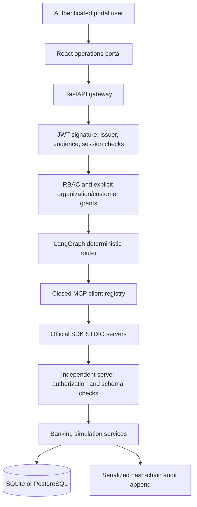
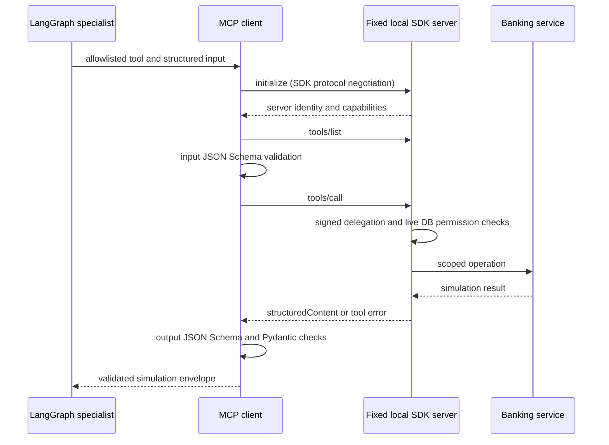
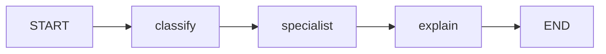

# Implemented architecture

Gateway-only human REST operations call the same deterministic services. Agents interact through MCP and never receive database credentials or unrestricted tool capabilities. STDIO servers are separate local processes with narrowly constructed environments. This is process separation within one host trust boundary, not independent workload identity. The server owns the banking DB integration.

## Data model

Organizations own users/customers/payments/workflows. Customer grants connect users to explicitly accessible customers. Accounts and beneficiaries belong to customers. Payments reference source account, beneficiary and maker. Approvals reference payment and independent approver with a unique pair. Execution has a unique payment reference. Audit events append through one locked sequence/hash head. Financial values use `NUMERIC(18,2)` and Python Decimal. Sessions reference users and support revocation.

The current migration contains 14 tables, not the full requested schema. Policy/roles are versioned code rather than editable DB tables. Workflow result JSON uses portable SQLAlchemy JSON. No customer documents or bank secrets are stored.

## Graph and provider

The fixed mock router selects customer, account, or payment specialist behavior, invokes one approved tool, and returns a Pydantic explanation. State includes workflow, user, organization, operation, agent, approved tool list and results; no credentials. This is an initial graph, not the requested ten-agent deployment. No free-text or external-document interpretation is offered yet. Structured schemas reject additional fields that try to inject roles or instructions. Full prompt-injection defense for unstructured sources remains pending.

## MCP boundaries

Three fixed servers expose four tools: customer profile, account balance, payment preparation, approved simulation execution. Each also exposes a public simulation policy resource and explanation prompt. A short-lived audience-bound signed ticket, created outside graph state, binds user/org/tool. Servers reload permissions and grants from the DB. Roles from clients or models are never accepted. Registry contains permission, classification, risk and approval metadata; schemas come from SDK definitions. Per-user client rate limit is 30/minute/process; concurrent MCP calls are limited to eight and each has a 30-second timeout. No automatic tool retries.

Remote registration, Streamable HTTP authentication, external server attestation, connection pooling, managed deactivation and persistent health history are not implemented. Protocol negotiation/discovery is performed by the SDK, never emulated with a custom message format.
