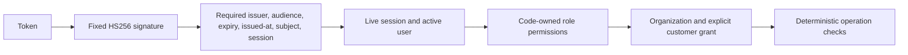
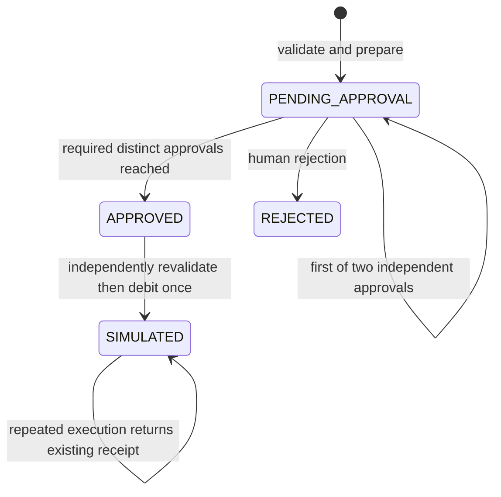
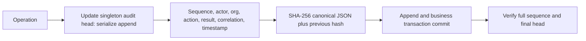

# Security model and limits

Assets: synthetic balances, instruction integrity, approval integrity, access scope, audit integrity, local signing key. Adversaries: unauthenticated callers, users requesting another organization's records, users attempting role injection, makers attempting self-approval, repeated/concurrent execution, and compromised external content. No external document ingestion is enabled.

## Identity and authorization

Argon2id password hashing uses pwdlib. PyJWT checks signed, required claims. An absent local key generates a process-local random key, so restart invalidates prior tokens; configure JWT_SECRET for stable local sessions. There is no default credential. Password login and HS256 are local demo authentication, **not OAuth 2.1 or OpenID Connect**. OIDC discovery/JWKS rotation, SSO flows, managed keys, MFA, refresh-token families and identity-provider logout are pending.

Permissions derive from a live DB user's role. Nine role names are defined; only implemented workflow permissions have routes. Role assignment is controlled by provisioning, not the request. Admin does not gain blanket customer access or payment approval. Customer grants and organization ownership are rechecked per operation. Fine-grained field disclosure is currently a fixed minimized profile/balance projection, not an editable field policy engine.

Login throttling and MCP rate limits are process-local, not distributed. Do not expose this demo to an untrusted network. The graph does not autonomously approve or execute payments. Live mode is rejected at configuration validation. Execution always simulates.

## Payment controls

INR only, amount strictly positive with two decimal places, maximum 1,000,000, flat fee 5. Required approvals are one below 100,000 and two at/above it. Expiration is one hour. Approval fingerprint binds source, beneficiary, amount, fee, currency, organization, maker, policy version, approval count and expiration. Material changes make prior approvals unusable. There is no edit endpoint; create a new instruction after expiry/change. Maker cannot approve own instruction. Approver permissions and grants are checked again at execution.

Payment row locks serialize decisions/execution. An atomic conditional account debit prevents concurrent overdrafts. Execution uniqueness and organization/maker/key uniqueness enforce idempotency. Status and audit updates commit in the same transaction as the balance debit. This is a single-source synthetic debit ledger, **not double-entry accounting or payment settlement**. Receipt/status must be inspected after an unknown timeout; there are no blind financial retries. PostgreSQL concurrency semantics still need deployment testing.

## Audit

Audit triggers reject UPDATE and DELETE. API exposes no mutation method. Hash-chain verification detects inconsistencies and truncation against the stored head. A database administrator can disable triggers and rewrite the entire chain/head: external signed checkpoints, isolated write credentials, protected storage and retention are required. **Tamper-evident is not tamper-proof.** The global head serializes all organization appends and limits throughput; verification reveals only a boolean to authorized auditors. Events returned to users are filtered by organization.

No passwords, raw bearer tokens, payment credential details or document content are recorded. Current audit records cover login/refresh/logout, service actions, completed/failed workflows, tool success/service rejection and HTTP exceptions. Request-schema errors, raw MCP identity failures and some infrastructure failures do not yet have comprehensive persisted security events. Audit infrastructure must be provisioned before serving requests.

## Production gaps

TLS termination, disk encryption, independent workload identity, remote MCP OAuth, distributed throttling, key rotation/secrets manager, immutable external audit retention, secure backups, OIDC, account-specific grants, policy decision persistence, infrastructure event monitoring, formal data retention, signed tool manifests, financial double-entry ledger and bank adapters are required before any production consideration. Process-wide DB credentials are available to banking server processes; this local host is one trust domain.
